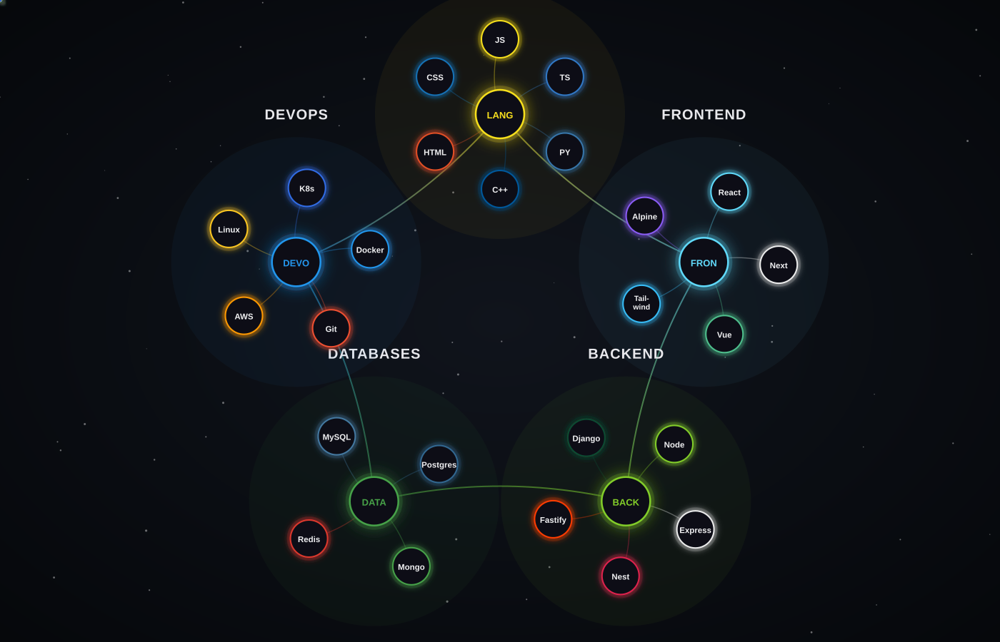

  <!-- TOP ANIMATED SVG HEADER BANNER -->
  

  

<!-- SECTION 1: ABOUT ME — ANIMATED SVG BUBBLE CARD -->

  

  

<!-- SECTION 2: TECHNICAL SKILL CONSTELLATION MATRIX WITH ANIMATED BANNER -->

  
    

  <!-- ANIMATED SKILL CONSTELLATION GRAPH SVG -->
  

  

<!-- SECTION 3: GITHUB STATS WITH ANIMATED BANNER -->

  
    

  <!-- STATS & STREAK CARDS -->
  
  &nbsp;&nbsp;
  

    

  <!-- COMPACT TOP LANGUAGES BAR -->
  

    

  <!-- SNAKE CONTRIBUTION GRAPH -->
  

